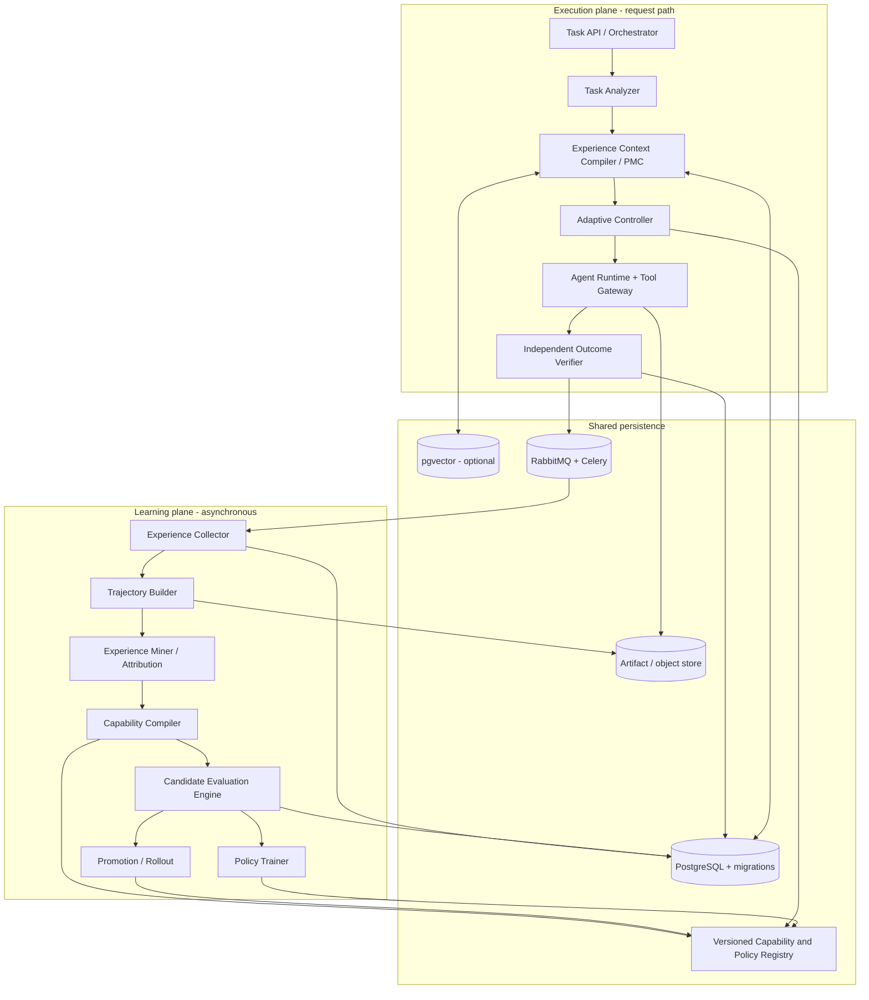

# Experience-Driven Self-Improving Agent — Architecture

> **Repository fit (Milestone 0):** the repository is greenfield. See [milestone-0-fit-gap-report.md](./milestone-0-fit-gap-report.md) for the component-to-path map, schema rollout, contract gaps (G1–G8), and [decisions/](./decisions/) for ADRs.

> **Milestone 1 contract changes:** `RunOutcome` additionally carries `task_id`, `tenant_id`, `config_id`, `policy_version`, `capability_version` and typed `verification_results`; `TaskSpec.success_criteria` is a typed discriminated union whose items have a `goal`/`guard` role and are never shown to the agent; `ControllerDecision` and `BenchmarkRunRecord` are new domain contracts (`src/experience_engine/domain/`). Review decisions: [ADR 0004](./decisions/0004-milestone-0-review-decisions.md). Benchmark and commands: [benchmark.md](./benchmark.md).

> **Milestone 2 contract changes:** new `TraceEvent`/`ArtifactRef`, `RunRecord`, `OutboxEvent`, `ExecutionCompletedPayload` and `LearningJob` contracts; tables, triggers and the event flow are documented in [schema.md](./schema.md) and [events.md](./events.md); decisions in [ADR 0005](./decisions/0005-m2-persistence-outbox-messaging.md).

> **Milestone 3 contract changes:** capability DSL/schema, `Trajectory`/`ExperienceCase`, run provenance tags and migration `0002`; see [capabilities.md](./capabilities.md), [schema.md](./schema.md) and [ADR 0006](./decisions/0006-m3-experience-and-capability-candidates.md).

> **Milestone 4 contract changes:** executor, applicability, promotion policy, evaluation report, registry service/state machine and migration `0003`; see [evaluation.md](./evaluation.md), [schema.md](./schema.md) and [ADR 0007](./decisions/0007-m4-evaluator-and-registry.md).

## 1. Objective and non-goals

### Objective
Build an agent that turns verified task experience into reusable capabilities and better execution decisions. Over a sequence of tasks, it should improve one or more of:

- verified task success and quality;
- transfer to tasks, repositories, configurations, or environments not used to create the capability;
- tokens, tool calls, latency, compute, and human effort per verified success;
- retention of earlier capabilities without harmful regressions.

The primary unit of improvement is **verified capability transfer**, not number of memories, summaries, or generated skills.

### Non-goals for the first release
- Modifying or fine-tuning the foundation model online.
- Executing arbitrary code generated by an LLM.
- Unrestricted self-modification of the agent or evaluator.
- Building a distributed microservice platform before the modular design is proven.
- Assuming vector similarity alone establishes applicability or authorizes execution.

## 2. Architecture at a glance

The system has two planes and shared storage.



Execution completion must not wait for learning. Persist the run/outcome and a transactional outbox event; workers process the event asynchronously.

## 3. Deployment shape

Start as a **modular monolith**:
- one FastAPI application for task and read/admin APIs;
- one runtime package (invoked synchronously or as a bounded task worker, depending on the current product);
- Celery workers for trajectory analysis, candidate compilation, evaluation, and policy training;
- PostgreSQL as source of truth;
- RabbitMQ for asynchronous jobs;
- pgvector only for retrieval cases where semantic matching proves useful;
- object storage for large trace payloads, patches, logs, and test artifacts.

Extract services only when independent scaling, isolation, deployment cadence, or ownership requires it. Keep domain interfaces independent of FastAPI, Celery, LangGraph, ORM, LLM vendor, and vector database.

## 4. Execution-plane components

### 4.1 Task API and orchestrator
Responsibilities:
- accept a task and caller-supplied or approved success criteria;
- create `task_id` and `run_id`;
- enforce tenant, permission, deadline, and resource budgets;
- coordinate analyzer, context compiler, controller, runtime, and verifier;
- persist status and return results.

Suggested `TaskSpec` fields:
- `task_id`, `tenant_id`, `objective`, `inputs`, `context_refs`;
- `task_family` (optional, initially inferred);
- `success_criteria` (structured and independently verifiable where possible);
- `max_tokens`, `max_steps`, `max_tool_calls`, `deadline_ms`;
- `risk_level`, `allowed_tools`, `environment_ref`.

Never let the executing LLM redefine success criteria after seeing the outcome.

### 4.2 Task analyzer
Extract structured features: task family/type, environment, relevant error/signal features, novelty estimate, complexity estimate, risk, and required tools. Use deterministic extraction where possible and model classification only where useful. Persist analyzer version and normalized features so experiments can be reproduced.

### 4.3 Experience Context Compiler (PMC)
Build a compact, provenance-aware context package from:
- episodic records: prior run references and outcomes;
- semantic facts: environment and domain facts;
- procedural records: approved capabilities and their preconditions;
- known counterexamples and failure boundaries.

Return references and concise selected facts, not entire historical conversations. Retrieval is advisory: capability eligibility and permissions are checked separately. Track retrieval latency, tokens added, hit usefulness, and task outcome to establish whether PMC adds value over lexical or structured retrieval.

### 4.4 Adaptive controller
Input: task features, context package, eligible capability versions, success/cost estimates, risk policy, and available budgets.
Output: selected strategy, capability composition, planner usage, reasoning budget, step budget, fallback, and decision rationale.

Initial strategies:
- `DIRECT_CAPABILITY`;
- `COMPOSE_CAPABILITIES`;
- `GENERAL_PLANNING`;
- `HUMAN_ESCALATION`.

Start with a deterministic policy, then add a contextual bandit after enough logged, verified outcomes exist. Do not start with unrestricted online RL. Log the full eligible action set, feature snapshot, estimates, policy version, selected action, selection probability, and reason.

Selection principle: minimize expected total cost subject to reliability, permission, safety, and risk constraints. Do not collapse all objectives into one opaque reward. Success thresholds and risk ceilings are hard constraints; cost is optimized within the feasible set.

### 4.5 Agent runtime and tool gateway
Support:
- deterministic capability execution;
- LLM-assisted decision steps inside a capability;
- general LLM planning when no capability is eligible or reliable;
- bounded retries, fallback, timeout, cancellation, and escalation.

All external tools go through a typed gateway with authentication, tenant authorization, allowlists, argument validation, rate limits, timeouts, and audit logging.

### 4.6 Outcome verifier
Return one of `VERIFIED_SUCCESS`, `FAILURE`, `PARTIAL`, or `UNKNOWN`. Use tests, builds, assertions, environment state, independent evaluators, or human approval as appropriate. Never treat an LLM's statement that it succeeded as sufficient evidence. Preserve evidence references and verifier version.

## 5. Learning-plane components

### 5.1 Experience collector and trajectory builder
Consume a completed-run outbox event, load ordered trace events, resolve artifact references, and build a trajectory/DAG of observations, decisions, actions, results, retries, verification, and outcomes. Keep the raw trace immutable. Summaries are derived views, not replacements for source evidence.

### 5.2 Experience miner
Group related task experiences and compare successful, failed, partial, and unknown trajectories. Identify:
- repeated useful action sequences;
- avoidable calls/retries/dead ends;
- conditions associated with success or failure;
- missing preconditions and counterexamples;
- candidate generalizations and combinations.

Treat discovered patterns as hypotheses, not causal facts. For important proposed changes, create intervention/ablation tests (remove or replace a step and compare under controlled conditions).

### 5.3 Capability compiler
Compile multiple experiences into an immutable, versioned capability candidate. Pipeline:
1. abstract task-specific details;
2. extract typed inputs/outputs;
3. create procedure steps using approved DSL primitives;
4. infer explicit preconditions and applicability boundaries;
5. add termination, verification, failure, and recovery conditions;
6. identify sub-capability dependencies;
7. attach source run IDs and evidence;
8. produce candidate test cases and known limitations.

Do not make a capability from every task. It is valid to update an existing capability's evidence or statistics without creating a new skill.

### 5.4 Capability DSL and executor
Initial allowed primitives:
- `TOOL_CALL` — approved tool and schema-validated arguments;
- `CONDITION` — branch on structured observations;
- `LLM_DECISION` — bounded model call for unresolved decisions;
- `ASSERT` — verify an invariant;
- `SUBCAPABILITY` — invoke an approved dependency;
- `RETRY` — bounded retry with explicit conditions;
- `VERIFY` — run an approved verification operation;
- `HUMAN_APPROVAL` — pause for explicit approval.

Never execute arbitrary model-generated Python, shell, SQL, or dynamic imports. Capability execution must enforce a maximum step count, wall-clock timeout, token budget, tool allowlist, network policy, tenant boundary, and cancellation. If a future sandboxed code capability is approved, it must run in an isolated environment with no ambient credentials and explicit resource/network limits.

### 5.5 Candidate evaluation engine
Every candidate must pass:
1. schema, dependency, permission, and static safety checks;
2. source-task replay (necessary, but not sufficient);
3. held-out validation tasks;
4. transfer tasks with changed repositories/configurations/task variants;
5. negative tests outside applicability conditions;
6. regression tests for previously solved tasks;
7. quality and resource-cost comparison against a fixed baseline.

Maintain three separate datasets: discovery, validation, and hidden transfer/evaluation. Do not expose hidden test cases or expected solutions to the compiler. Record dataset version, seeds, model version, runtime version, and environment image.

Promotion is gated by minimum evidence, required success confidence for the risk tier, no unacceptable regressions, and documented applicability. Use shadow then canary rollout. Keep prior versions and rollback support.

### 5.6 Capability registry
Store immutable capability versions, current rollout state, dependencies, provenance, evaluation reports, and runtime statistics. State transitions must be audited. Suggested lifecycle:
`DISCOVERED -> CANDIDATE -> VALIDATING -> APPROVED -> SHADOW -> CANARY -> ACTIVE` with `REJECTED`, `DEPRECATED`, and `ROLLED_BACK` terminal/side states.

### 5.7 Policy trainer
Begin with offline estimation and rule-based selection. Later train a contextual bandit on logged decisions and verified outcomes. Use safe exploration only for low-risk task classes. Require offline replay, calibration checks, shadow evaluation, canary rollout, and rollback before activating a new policy. Do not train on unverified/self-reported success.

## 6. Core contracts

### TaskSpec
```python
class TaskSpec(BaseModel):
    # Import Field from pydantic; use factories for mutable defaults.
    task_id: str
    tenant_id: str
    objective: str
    inputs: dict[str, object] = Field(default_factory=dict)
    context_refs: list[str] = Field(default_factory=list)
    task_family: str | None = None
    success_criteria: list[dict[str, object]]
    max_tokens: int
    max_steps: int
    max_tool_calls: int
    deadline_ms: int
    risk_level: str
    allowed_tools: list[str] = Field(default_factory=list)
```

### RunOutcome
```python
class RunOutcome(BaseModel):
    run_id: str
    status: Literal["VERIFIED_SUCCESS", "FAILURE", "PARTIAL", "UNKNOWN"]
    quality_score: float | None
    verification_results: list[dict[str, object]]
    tokens_used: int
    tool_calls: int
    execution_time_ms: int
    human_interventions: int
    failure_reasons: list[str]
    evidence_refs: list[str]
    verifier_version: str
```

### Capability definition (conceptual contract)
```json
{
  "id": "database_connection_diagnostics",
  "version": 1,
  "objective": "Diagnose intermittent database connection failures",
  "inputs_schema": {},
  "outputs_schema": {},
  "preconditions": [],
  "steps": [
    {"op": "TOOL_CALL", "tool": "inspect_logs", "args": {}},
    {"op": "CONDITION", "condition": "failure_after_idle", "then": []},
    {"op": "VERIFY", "verifier": "recovery_test"}
  ],
  "termination": [],
  "failure_conditions": [],
  "recovery": [],
  "dependencies": [],
  "permissions": [],
  "budgets": {"max_steps": 12, "max_tokens": 4000, "timeout_ms": 60000},
  "provenance": {"source_run_ids": [], "compiler_version": ""}
}
```

Use real JSON Schema/Pydantic validation; the example is illustrative. Definitions are immutable once registered as a version.

### Execution event
Each event should include `event_id`, `tenant_id`, `task_id`, `run_id`, `sequence`, `parent_event_id` or trace/span ID, event type, component/version, timestamp (UTC), action, status, metrics, and artifact references. Do not persist secrets or unrestricted raw tool payloads in event metadata.

## 7. Persistence model

Initial source of truth: PostgreSQL. Suggested tables:
- `tasks`;
- `task_runs`;
- `trace_events` (append-only, partition later if needed);
- `run_outcomes`;
- `experience_cases`;
- `memory_items` (pgvector only if used);
- `capabilities` (stable identity);
- `capability_versions` (immutable definition and status);
- `capability_evidence`;
- `capability_edges` (dependency/composition relation);
- `capability_evaluations`;
- `policy_versions`;
- `policy_decisions`;
- `outbox_events`;
- `audit_log`.

All tenant-owned tables must be tenant-scoped. Add indexes for tenant/run/time/state lookups. Large artifacts belong in object storage with tenant-scoped access and content hashes. Use Alembic migrations and explicit repository interfaces. Avoid introducing a graph database in the MVP; capability edges can be relational rows.

## 8. Event flow and reliability

On task completion:
1. Persist run status, outcome, trace metadata, and an outbox row in one transaction.
2. Outbox publisher sends `execution.completed` or `outcome.verified` to RabbitMQ.
3. A worker claims the event idempotently and builds the trajectory.
4. Learning jobs use deduplication keys such as `(run_id, pipeline_version)`.
5. Candidate evaluation jobs use immutable candidate and dataset versions.
6. Promotion updates registry state transactionally and emits an audit/event record.

Use bounded retries, exponential backoff with jitter, dead-letter queues, visibility into poison messages, and a reconciliation job for unprocessed outbox rows. Never assume exactly-once delivery; design for at-least-once delivery with idempotent handlers.

## 9. Measurement and benchmark protocol

Keep at least these configurations:
- A: fixed baseline, no persistent learning;
- B: episodic memory/retrieval only;
- C: compiled capabilities, no learned controller;
- D: capabilities plus adaptive controller;
- E: D plus PMC.

Use identical foundation model, tool access, budgets, and environment where possible. Compare on task sequences and fresh sessions. Split by task family, repository, configuration, and time. Do not allow discovery traces to leak into hidden transfer tests.

Metrics:
- verified success and quality;
- transfer performance on unseen tasks;
- tokens, tool calls, latency, compute, and human interventions per verified success;
- learning and maintenance cost;
- lifecycle cost over N tasks;
- regression/forgetting and capability retention;
- calibration and false applicability rate.

Lifecycle cost must include candidate generation, evaluation, storage/retrieval, maintenance, and execution. A lower token count is not an improvement if correctness or required verification falls.

## 10. Security and governance

- Enforce tenant isolation in retrieval, experience mining, registry queries, artifacts, and evaluation.
- Never use one tenant's private data to improve another tenant's capabilities unless explicit opt-in and an approved anonymization/data-sharing policy exist.
- Treat LLM-generated candidates, retrieved content, tool outputs, and artifacts as untrusted data, not instructions.
- Secrets must come from a credential provider, never from memory or capability definitions.
- Tool permissions and safety constraints are deterministic gates outside learned policies.
- Evaluation datasets, promotion criteria, and audit records must be protected from the learning agent.
- New capability/policy versions require rollback-ready deployment and audit trails.

## 11. Observability

Propagate `task_id`, `run_id`, `tenant_id`, trace ID, capability ID/version, policy version, and learning pipeline version. Capture model/token metrics, tool-call metrics, timings, retries, verifier results, candidate evaluation results, and rollout state. Avoid logging secrets, private prompts, or unnecessary user data.

## 12. Implementation principle

Build one vertical slice at a time. First make execution measurable; then collect traces; then compile candidates; then validate and promote; then let the runtime use capabilities; then learn strategy selection; only then prove PMC's incremental value and attempt bounded self-evolution.
